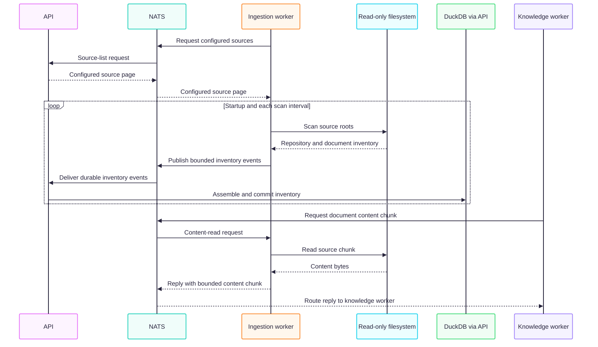

# Ingestion worker

The ingestion worker periodically discovers sources registered with the API,
scans their configured filesystem roots, and reports inventory changes. It
does not own the catalogue and does not modify source files.

## Operating flow

## Connections

- **Upstream:** requests the configured source list from the API over NATS
  request/reply. The API loads source and workspace rules from
  [`config/workspace-brain.yaml`](../../config/workspace-brain.yaml).
- **Filesystem:** uses the
  [`@workspace-brain/filesystem`](../../infrastructure/filesystem/) adapter to
  scan roots and read document content in bounded chunks. In Compose, source
  files are mounted read-only at `/sources`.
- **NATS:** publishes source-scan and inventory events to the durable
  `WORKSPACE_DISCOVERY` JetStream stream. The API consumes these events,
  validates and persists inventory in DuckDB, then emits document discovery
  and processing events.
- **Downstream:** the knowledge worker consumes document discovery and
  extraction events. When processing needs source content, it requests bounded
  chunks from the ingestion worker over NATS; the worker reads those bytes
  from the registered source rather than copying whole files into the catalogue.

The worker refreshes the source list and requests scans on startup and at the
configured interval. A scan publishes a bounded inventory transfer so the API
can assemble and commit a complete scan consistently.

## Runtime and configuration

In the standard Compose setup this runs as the `ingestion-worker` container,
with `NATS_SERVERS=nats://nats:4222` and a read-only source mount. Relevant
settings include `WORKSPACE_SOURCES_PATH` (host path mounted by Compose),
`SCAN_INTERVAL_MS`, and the `DISCOVERY_INVENTORY_*` payload and batching
limits. Runtime heartbeat settings are documented in the
[observability guide](../../docs/architecture/runtime-observability.md).

Use the [local runtime guide](../../docs/local-development.md) for startup,
rebuild, reprocessing, and verification commands. Rebuild this worker after
ingestion-only code changes with `make rebuild-ingestion-worker`; changes to
shared contracts may require rebuilding other backend consumers too.
