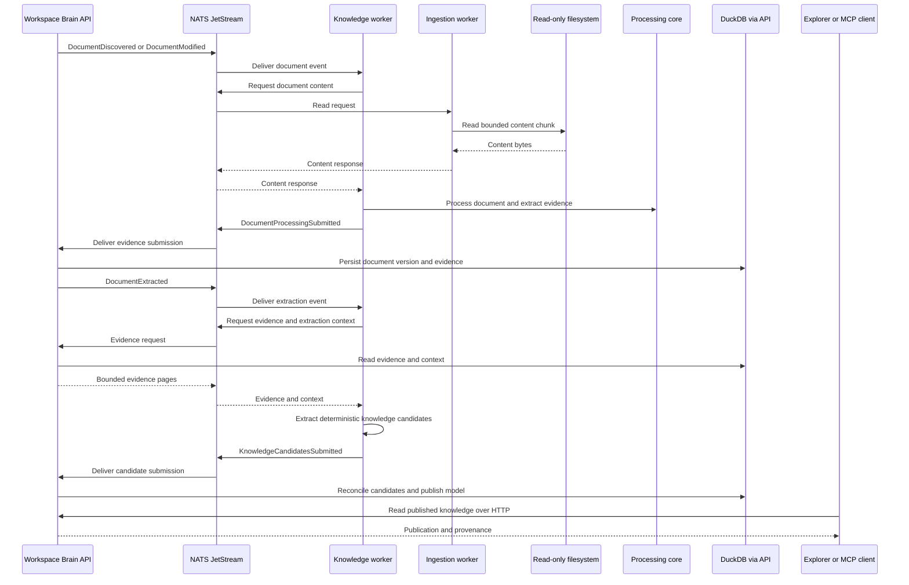

# Knowledge worker

The knowledge worker turns extracted, provenance-bearing document evidence
into deterministic knowledge candidates. It runs the processors and extractors
in [`packages/processing-core`](../../packages/processing-core/) and submits
the results for reconciliation; it does not write DuckDB or publish a
Knowledge Model itself.

## Operating flow

## Connections

- **Upstream:** consumes `DocumentDiscovered` and `DocumentModified` events
  from the API-backed `WORKSPACE_DISCOVERY` JetStream stream. The processing
  pipeline obtains document bytes from the ingestion worker through NATS
  request/reply.
- **Evidence:** after extraction, consumes `DocumentExtracted` and requests
  its evidence and extraction context from the API over NATS. The API reads
  this input from the DuckDB catalogue and returns bounded pages.
- **Downstream:** publishes `KnowledgeCandidatesSubmitted` events over NATS.
  The API validates and reconciles candidates, maintains the Knowledge Model,
  and creates immutable publications. Consumers read those publications
  through the API rather than from this worker or the catalogue.

This boundary keeps document processing independent of catalogue writes and
ensures published knowledge remains under API ownership with evidence and
provenance attached.

## Runtime and configuration

In Compose this runs as the `knowledge-worker` container and connects to NATS
at `nats://nats:4222`. It uses `LOG_LEVEL` and the shared runtime-heartbeat
settings. See the [local runtime guide](../../docs/local-development.md) for
startup, rebuilding, reprocessing, and verification. Rebuild this worker
after worker-only changes with `make rebuild-knowledge-worker`. Changes to
`processing-core` also affect the API, so rebuild both consumers and reprocess
existing documents when changed logic should update generated knowledge.
