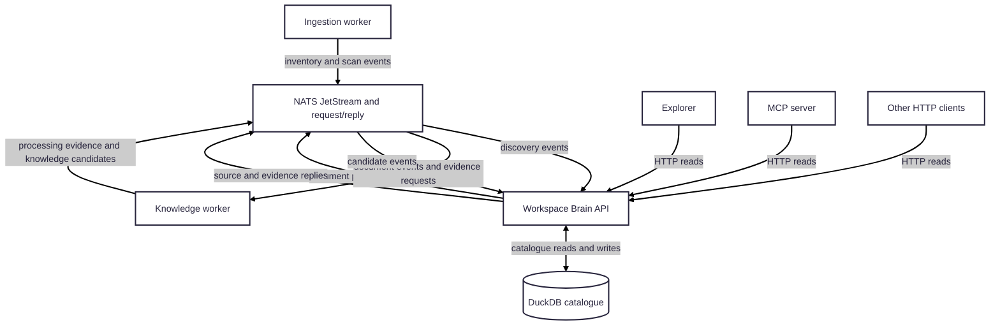

# Workspace Brain API

The API is the catalogue owner and public read interface for Workspace Brain.
It serves the versioned HTTP API used by Explorer, the MCP server, and other
clients; it also handles internal discovery and candidate events from the
workers. Its public knowledge endpoints expose evidence-backed current state
and immutable publications without giving consumers direct storage access.

## Connections

- **Configuration:** loads source, workspace, and discovery rules from
  [`config/workspace-brain.yaml`](../../config/workspace-brain.yaml).
- **Storage:** opens the
  [`@workspace-brain/duckdb`](../../infrastructure/duckdb/) catalogue and
  applies pending migrations at startup. The API is the only application
  process that writes the catalogue.
- **NATS:** connects to the
  [`NATS JetStream event backbone`](../../infrastructure/nats/). It receives
  durable worker events, publishes processing and reconciliation events,
  answers worker requests for configured sources and evidence, and tracks
  runtime heartbeats.
- **Upstream workers:** ingestion submits scan inventories and discovery
  events; the knowledge worker submits evidence-derived knowledge candidates.
  The API validates and persists these, then reconciles and publishes
  Knowledge Models.
- **Downstream clients:** Explorer and MCP call the HTTP API. The API returns
  published knowledge, provenance, search results, exports, comparisons,
  currency, health, and runtime status. Clients do not connect directly to
  DuckDB or NATS.

The API also coordinates search-projection updates and publication work. Its
HTTP handlers and internal event consumers share the same catalogue, so
catalogue mutation remains at one service boundary.

## Runtime and configuration

Compose runs this as `workspace-brain-api`, normally on
`http://localhost:3000`. Important settings include `PORT`, `HOST`,
`CATALOGUE_PATH`, `CONFIG_PATH`, `DUCKDB_MIGRATIONS_DIR`, `NATS_SERVERS`,
`DUCKDB_MEMORY_LIMIT_MB`, and `DUCKDB_THREADS`. Compose stores the catalogue
in the persistent `catalogue-data` volume. `/health` is the container
liveness check; use `/ready` for database-backed readiness diagnostics.

Use the [local runtime guide](../../docs/local-development.md) for startup,
verification, and change-to-command guidance. API, catalogue, or migration
changes require `make rebuild-api`; restarting an existing image does not
deploy code changes.
