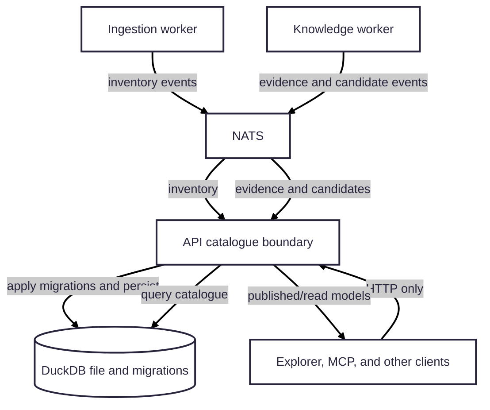

# DuckDB catalogue

This package provides Workspace Brain's embedded operational catalogue. It
implements the catalogue interfaces used by the API; it is not a standalone
database service and workers and user-facing clients do not connect to it.

## Connections and ownership

- The **API** opens DuckDB through `@workspace-brain/duckdb`, applies the
  ordered SQL migrations in [`migrations/`](migrations/), and is the sole
  application writer.
- The **ingestion worker** sends inventory and document events over NATS;
  the API persists discovery state here.
- The **knowledge worker** gets evidence and extraction context from the API
  over NATS and returns candidates. The API stores evidence, reconciles
  candidates, and builds immutable publications and search projections here.
- **Explorer, MCP, and other consumers** read catalogue-derived information
  through the API's HTTP contract, never by opening the DuckDB file.

The catalogue contains configured sources and workspaces, repositories and
documents, scan/inventory history, document versions and evidence, knowledge
models and publication snapshots, search projections, and publication
comparisons and exports. NATS provides event delivery; it is not a substitute
for this queryable catalogue. Conversely, DuckDB does not replace NATS for
worker communication.

## Persistence and migrations

The Compose API uses `CATALOGUE_PATH=/var/lib/workspace-brain/catalogue.duckdb`
and mounts the persistent `catalogue-data` volume at
`/var/lib/workspace-brain`. The migration directory is supplied through
`DUCKDB_MIGRATIONS_DIR`. Startup applies unapplied migrations before the API
opens its listener; migration failures prevent startup rather than silently
starting against an incomplete schema.

Changes to this package or its migrations affect the API image. Use
`make rebuild-api`; see the [local runtime guide](../../docs/local-development.md)
for deployment and readiness checks. Do not delete the data volume as a
routine rebuild step.
