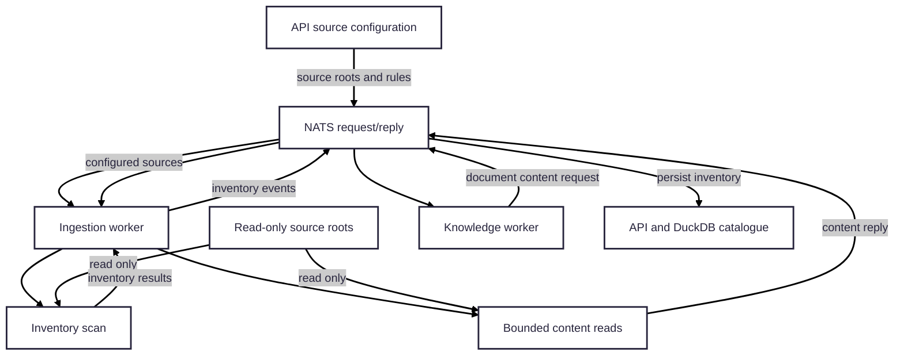

# Filesystem adapter

This package implements the filesystem boundary used by the ingestion worker.
It discovers repositories and eligible documents under registered source
roots, fingerprints the inventory, and reads document contents in bounded
chunks for processing.

## Connections and boundaries

- The **API** owns source definitions and workspace include/exclude rules and
  provides the configured roots to the ingestion worker over NATS.
- The **ingestion worker** calls this adapter to scan those roots and to serve
  bounded content-read requests from the knowledge-processing pipeline.
- The **knowledge worker** receives content through the ingestion worker; it
  does not access source mounts itself.
- The **source files** remain authoritative and are accessed read-only. The
  adapter neither writes to sources nor stores their contents in DuckDB.

The adapter returns scan results and content chunks to its caller. The
ingestion worker publishes inventory events, and the API stores catalogue
state. This keeps filesystem traversal and file-handle safety separate from
catalogue and event-bus concerns.

## Runtime

There is no filesystem container or long-running process. In Compose, the
ingestion worker mounts the configured host source directory read-only at
`/sources`. Set `WORKSPACE_SOURCES_PATH` in `deploy/compose/.env` to select a
different host directory; source configuration and discovery rules are in
[`config/workspace-brain.yaml`](../../config/workspace-brain.yaml).

See the [ingestion worker guide](../../apps/ingestion-worker/README.md) and the
[local runtime guide](../../docs/local-development.md) for end-to-end setup.
