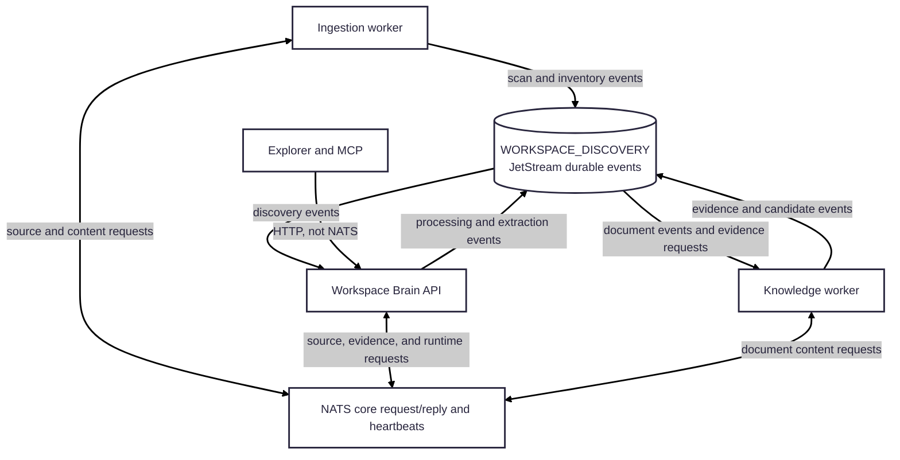

# NATS event backbone

NATS provides internal messaging between the API and backend workers. The
Workspace Brain adapter is the `@workspace-brain/nats` package; it provisions
and consumes the JetStream stream, encodes discovery events, provides
request/reply, and publishes runtime heartbeats.

## Connections and flow

- The **ingestion worker** requests configured sources and document content
  from the API, and publishes scan and inventory events.
- The **API** consumes and persists discovery events, requests document
  processing, supplies evidence to the knowledge worker, consumes candidate
  submissions, and maintains runtime status from heartbeats.
- The **knowledge worker** consumes document discovery and extraction events,
  requests evidence from the API, and publishes knowledge candidates.
- **Explorer and MCP** are API clients, not NATS clients. They use the public
  HTTP API for knowledge and runtime status.

Durable discovery events use the `WORKSPACE_DISCOVERY` JetStream stream,
covering `workspace.discovery.>`, `workspace.processing.>`,
`workspace.knowledge.>`, and `workspace.search.>`. Durable consumers
explicitly acknowledge successful handling, retry failures, and publish
exhausted events to `workspace.discovery.dead-letter`. Request/reply subjects
and runtime heartbeats use NATS core messaging; heartbeats are transient
status signals, not durable work events.

## Runtime and operations

Compose runs `nats:2.10-alpine` with JetStream enabled and file storage at
`/data`, backed by the persistent `nats-data` volume. Backend services connect
on the Compose network using `nats://nats:4222`. The local client and monitor
ports default to `4222` and `8222`; the monitor port is not an application API.

See [ADR-012](../../docs/adr/ADR-012-nats-jetstream-event-backbone.md) for the
event-backbone decision, the
[inventory transfer guide](../../docs/architecture/source-inventory-transfer.md)
for bounded transfers and recovery behavior, and the
[runtime observability guide](../../docs/architecture/runtime-observability.md)
for heartbeat semantics. Rebuilding an application does not clear retained
JetStream messages; do not delete `nats-data` as a routine update step.
